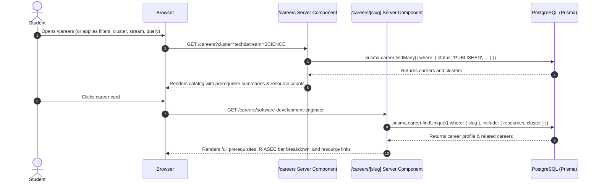
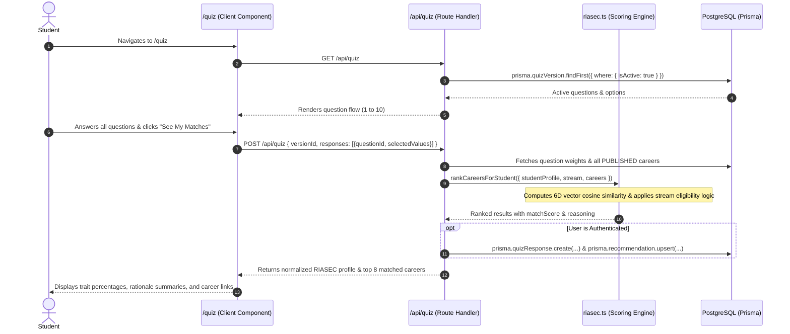
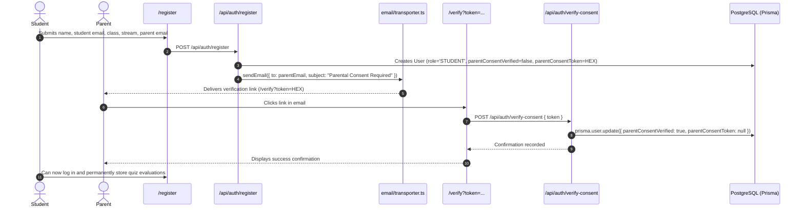
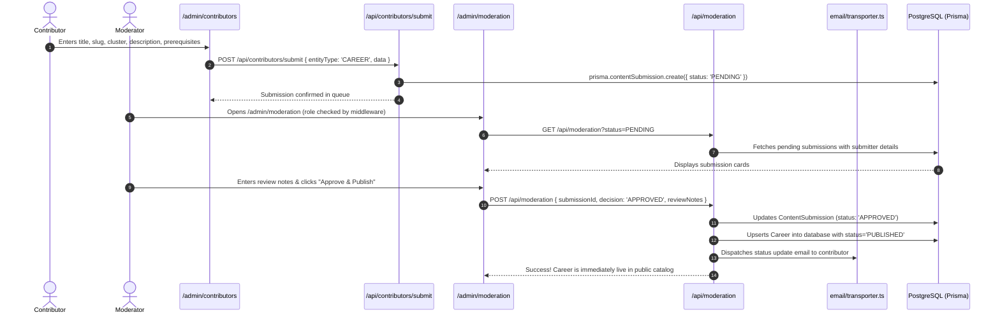

# Disha (दिशा) — Codebase Architecture & Technical Documentation

> **Status:** MVP Implemented, Tested, Migrated, and Seeded  
> **Target Audience:** Indian High School Students (Classes 9–12, ages 14–18)  
> **Core Stack:** Next.js 16 (App Router), React 19, TypeScript, Tailwind CSS v4, Prisma 6, NextAuth.js v5, PostgreSQL

---

## 1. Project Overview & Mission

**Disha (दिशा)** is an evidence-backed, open-access career exploration and recommendation platform tailored specifically to high school students in India. It addresses critical decision bottlenecks:
1. **Stream Selection (Post-Class 10):** Guiding students between Science (PCM/PCB), Commerce, Arts/Humanities, or vocational pathways.
2. **Career & Entrance Exam Navigation (Class 11–12):** Mapping prerequisites, eligibility criteria, and competitive entrance examinations (e.g., JEE, NEET, CLAT, NATA, NID DAT, UPSC CSE, CA Foundation).
3. **Evidence-Based Matching:** Replacing subjective advice with Holland Codes (RIASEC) 6-dimensional psychological aptitude scoring.
4. **Regulatory Minor Compliance:** Strict compliance with India's **Digital Personal Data Protection Act (DPDPA) 2023**, enforcing verifiable parental consent prior to minor profile storage while preserving open, unauthenticated browsing.
5. **Community-Curated, Moderator-Vetted Quality:** An editorial pipeline enabling approved contributors to submit career pathways and vetted free/paid learning resources, reviewed by moderators before publication.

---

## 2. Directory Structure & File Map

```
disha/
├── CODEBASE_DOCUMENTATION.md          # Comprehensive technical and architectural guide
├── README.md                          # Project introduction and quickstart instructions
├── AGENTS.md                          # Next.js 16 App Router agent conventions
├── package.json                       # Scripts, dependencies, and Prisma seed definition
├── tsconfig.json                      # TypeScript compiler configuration (strict mode, '@/*' alias)
├── next.config.ts                     # Next.js configuration
├── eslint.config.mjs                  # ESLint flat config
├── docker-compose.yml                 # Local containerized PostgreSQL 16 service
├── .env.example                       # Documented environment variable template
├── .env                               # Active local environment variables
│
├── prisma/
│   ├── schema.prisma                  # Data models, relations, enums, and indexes
│   ├── seed.ts                        # Seed script: 8 clusters, 36 careers, 53 resources, 10 quiz questions
│   └── migrations/
│       └── 20261019201410_init/       # Baseline PostgreSQL migration SQL
│
├── src/
│   ├── middleware.ts                  # Route protection and role-based access control
│   │
│   ├── constants/
│   │   └── riasec.ts                  # Holland Codes definitions, dimensions, and cluster mappings
│   │
│   ├── types/
│   │   ├── index.ts                   # Core domain types, re-exported Prisma enums, API contracts
│   │   └── next-auth.d.ts             # Module augmentation extending NextAuth session/JWT
│   │
│   ├── lib/
│   │   ├── prisma.ts                  # Global PrismaClient singleton
│   │   ├── auth.ts                    # NextAuth v5 configuration with Credentials & Google providers
│   │   ├── scoring/
│   │   │   └── riasec.ts              # Vector cosine similarity matching & ranking algorithm
│   │   ├── email/
│   │   │   ├── transporter.ts         # Nodemailer SMTP transport with local dev simulation fallback
│   │   │   └── templates.ts           # HTML email templates (DPDPA consent, invites, moderation updates)
│   │   └── validators/
│   │       ├── auth.ts                # Zod schemas for student registration and login
│   │       ├── career.ts              # Zod schemas for clusters, careers, and learning resources
│   │       └── quiz.ts                # Zod schema for quiz response submissions
│   │
│   ├── components/
│   │   ├── layout/
│   │   │   └── Navbar.tsx             # Global responsive client navigation bar
│   │   ├── ui/                        # [Directory scaffolded for shared primitive components]
│   │   ├── admin/                     # [Directory scaffolded for modular admin components]
│   │   ├── quiz/                      # [Directory scaffolded for modular quiz components]
│   │   └── careers/                   # [Directory scaffolded for modular career cards]
│   │
│   ├── hooks/                         # [Directory scaffolded for shared custom React hooks]
│   │
│   └── app/
│       ├── layout.tsx                 # Root HTML shell with Inter font and SEO metadata
│       ├── globals.css                # Tailwind CSS v4 styling rules and palette
│       ├── page.tsx                   # Public landing page with cluster previews and CTAs
│       │
│       ├── (public)/
│       │   ├── careers/
│       │   │   └── page.tsx           # Searchable, stream- and cluster-filtered career directory
│       │   │   └── [slug]/
│       │   │       └── page.tsx       # In-depth career guide (prerequisites, RIASEC profile, resources)
│       │   └── quiz/
│       │       └── page.tsx           # Interactive 10-question RIASEC quiz with real-time match preview
│       │
│       ├── (auth)/
│       │   ├── login/
│       │   │   └── page.tsx           # Authentication page with demo credentials quick-fill
│       │   ├── register/
│       │   │   └── page.tsx           # Registration capturing class, stream, and parent consent email
│       │   └── verify/
│       │       └── page.tsx           # Suspense-wrapped parent consent confirmation handler
│       │
│       ├── (dashboard)/
│       │   ├── dashboard/
│       │   │   └── page.tsx           # Student portal (consent badge, RIASEC breakdown, saved matches)
│       │   └── recommendations/       # [Scaffolded route directory]
│       │
│       ├── (admin)/
│       │   └── admin/
│       │       ├── moderation/
│       │       │   └── page.tsx       # Editorial queue (PENDING, APPROVED, CHANGES_REQUESTED, REJECTED)
│       │       ├── contributors/
│       │       │   └── page.tsx       # Contributor portal for authoring new career pathways
│       │       ├── careers/           # [Scaffolded route directory]
│       │       └── users/             # [Scaffolded route directory]
│       │
│       └── api/
│           ├── auth/
│           │   ├── [...nextauth]/route.ts  # NextAuth API route handler
│           │   ├── register/route.ts       # Student registration endpoint + consent email dispatch
│           │   └── verify-consent/route.ts # Token validation activating minor student accounts
│           ├── careers/
│           │   ├── route.ts                # Catalog query endpoint (search, cluster, stream filters)
│           │   └── [slug]/route.ts         # Career profile detail endpoint + related career links
│           ├── quiz/
│           │   └── route.ts                # Quiz question fetcher + RIASEC scoring and evaluation
│           ├── contributors/
│           │   └── submit/route.ts         # Contributor submission ingest into moderation queue
│           ├── moderation/
│           │   └── route.ts                # Moderator decision processing & auto-publishing
│           ├── admin/                      # [Scaffolded API directory]
│           └── recommendations/            # [Scaffolded API directory]
```

---

## 3. Detailed File Inventory & Component Architecture

### Configuration & Infrastructure

| File | Purpose | Key Exports / Interconnections |
|---|---|---|
| `docker-compose.yml` | Spawns a dedicated local PostgreSQL 16 container on port `5432`. | Consumed by local development and Prisma CLI via `DATABASE_URL`. |
| `.env` / `.env.example` | Declares database connection, NextAuth secrets, SMTP email credentials, and OAuth keys. | Loaded automatically by Next.js and Prisma. |
| `package.json` | Configures dependencies, build scripts, and Prisma seed command (`tsx prisma/seed.ts`). | Runs Next 16, React 19, Prisma 6, and NextAuth beta. |
| `next.config.ts` | Next.js configuration. Standard config compatible with Next 16 Turbopack build worker. | Consumed by `next build` and `next dev`. |

### Database & Seed Pipeline (`prisma/`)

| File | Purpose | Key Details |
|---|---|---|
| `prisma/schema.prisma` | Full schema declaration with 10 models and 8 enums. | Enums: `UserRole`, `AcademicStream`, `ContentStatus`, `ResourceType`, `ResourceCost`, `QuestionType`, `SubmissionEntityType`, `SubmissionAction`, `SubmissionStatus`. Models: `User`, `Account`, `Session`, `VerificationToken`, `CareerCluster`, `Career`, `CareerResource`, `QuizVersion`, `QuizQuestion`, `QuizResponse`, `Recommendation`, `ContentSubmission`. |
| `prisma/seed.ts` | Idempotent seed script. Upserts 8 career clusters, 36 careers, 53 resources, 10 RIASEC questions, and default Admin/Moderator accounts. | Uses `bcrypt` to hash credentials; maps RIASEC profiles and educational prerequisites for Indian contexts. |
| `prisma/migrations/...` | Initial SQL migration file establishing tables, indexes, constraints, and relations. | Applied to Postgres via `npx prisma migrate dev`. |

### Shared Libraries & Utilities (`src/lib/`, `src/types/`, `src/constants/`)

| File | Purpose | Connections |
|---|---|---|
| `src/lib/prisma.ts` | Singleton instance of `PrismaClient` preventing connection pool exhaustion in development. | Imported across all API route handlers and Server Components. |
| `src/lib/auth.ts` | NextAuth v5 setup using `@auth/prisma-adapter`, `CredentialsProvider` (with bcrypt), and optional Google OAuth. | Configures JWT session strategy, custom login/registration pages, and token callbacks augmenting user role. |
| `src/middleware.ts` | Edge route guard intercepting requests to `/dashboard`, `/recommendations`, and `/admin/*`. | Redirects unauthenticated users to `/login?callbackUrl=...` and unauthorized roles to `/`. |
| `src/constants/riasec.ts` | Holland Codes dimension metadata (labels, codes, keywords) and cluster-to-RIASEC affinity mappings. | Used by quiz scoring algorithm, career detail page, and dashboard. |
| `src/lib/scoring/riasec.ts` | Mathematical matching engine. Calculates vector cosine similarity between student responses and career vectors. | Computes 0–100 match score, applies academic stream eligibility adjustments, and formats human-readable rationale. |
| `src/lib/email/transporter.ts` | Nodemailer SMTP client. Safely falls back to formatted console logging in dev if SMTP credentials are unset. | Invoked by `/api/auth/register` and `/api/moderation`. |
| `src/lib/email/templates.ts` | Produces branded HTML email templates for parental consent verification, contributor invites, and submission status updates. | Consumed by `transporter.ts`. |
| `src/lib/validators/*.ts` | Zod validation schemas for registration, login, career clusters, careers, resources, and quiz responses. | Enforces strict validation at API boundaries. |
| `src/types/index.ts` | Type definitions for RIASEC scores, Quiz questions, API payloads, and re-exports of Prisma enums. | Provides unified types across client and server. |
| `src/types/next-auth.d.ts` | TypeScript declaration augmentation extending `next-auth` `Session` and `JWT` to include `role` and `parentConsentVerified`. | Ensures full type safety when accessing `session.user.role`. |

### UI & Public Pages (`src/app/`, `src/components/`)

| File | Purpose | Connections |
|---|---|---|
| `src/components/layout/Navbar.tsx` | Global responsive header featuring Disha branding, navigation links, login/register triggers, and active path highlights. | Included in all page layouts. |
| `src/app/page.tsx` | Landing page featuring product mission, RIASEC methodology, DPDPA safety summary, and 8 cluster quick-links. | Entry point (`/`). |
| `src/app/(public)/careers/page.tsx` | Server Component querying published careers. Supports live text search, stream dropdown filtering, and cluster tab switching. | Reads query params `?cluster=`, `?stream=`, `?q=`. Fetches data directly via Prisma. |
| `src/app/(public)/careers/[slug]/page.tsx` | Deep-dive career profile displaying educational duration, stream eligibility, prerequisites checklist, RIASEC progress bars, verified resources, and related paths. | Dynamic Server Component parameterized by `[slug]`. |
| `src/app/(public)/quiz/page.tsx` | Client Component orchestrating the 10-question RIASEC assessment. Features progress tracking, auto-advance, scoring calculation, top personality traits, and instant career recommendations. | Calls `/api/quiz` (GET & POST). Prompts unauthenticated students to create an account to persist results. |
| `src/app/(auth)/register/page.tsx` | Student sign-up form capturing Name, Email, Password, Class (9–12), Stream, and Parent Email. | Calls `POST /api/auth/register`. Informs student of pending parental consent. |
| `src/app/(auth)/login/page.tsx` | Credential login form with demo credentials quick-fill buttons for Admin (`admin@disha.app`) and Moderator (`moderator@disha.app`). | Invokes `signIn('credentials')` via NextAuth. |
| `src/app/(auth)/verify/page.tsx` | Suspense-wrapped client handler extracting `?token=` to record verifiable parental consent under DPDPA. | Calls `POST /api/auth/verify-consent`. |
| `src/app/(dashboard)/dashboard/page.tsx` | Authenticated student portal displaying DPDPA consent status badge, latest RIASEC trait distribution, and saved personalized recommendations. | Protected Server Component reading `auth()` session and querying user records. |
| `src/app/(admin)/admin/moderation/page.tsx` | Content moderation dashboard with status tabs (`PENDING`, `APPROVED`, `CHANGES_REQUESTED`, `REJECTED`), payload preview, notes input, and decision triggers. | Calls `GET /api/moderation` and `POST /api/moderation`. Restricted to `ADMIN` and `MODERATOR`. |
| `src/app/(admin)/admin/contributors/page.tsx` | Contributor authoring screen allowing approved contributors and admins to submit structured career pathways directly into the review queue. | Calls `POST /api/contributors/submit`. |

---

## 4. End-to-End Data Flow Architectures

### 1. Anonymous Exploration & Public Career Browsing


---

### 2. Quiz Evaluation & RIASEC Recommendation Flow


---

### 3. DPDPA 2023 Parental Consent & Student Onboarding Flow


---

### 4. Community Contributor & Moderation Publishing Flow


---

## 5. API Integrations & External Services

| Service / Layer | Integration Method | Configuration | Fallback Behavior |
|---|---|---|---|
| **Database** | Prisma 6 Client over TCP connection pool | `DATABASE_URL` in `.env` | Connects to local Docker PostgreSQL or serverless Neon instance. |
| **Authentication** | NextAuth.js v5 (Auth.js) beta | `NEXTAUTH_SECRET`, `NEXTAUTH_URL` | JWT session strategy stored in encrypted client cookies. |
| **Google OAuth** | Optional NextAuth provider | `GOOGLE_CLIENT_ID`, `GOOGLE_CLIENT_SECRET` | Enabled automatically only when environment variables are supplied; credentials provider remains active. |
| **Email Service** | Nodemailer SMTP transport | `SMTP_HOST`, `SMTP_PORT`, `SMTP_USER`, `SMTP_PASSWORD` | When credentials are placeholder or absent in development, `transporter.ts` logs rendered HTML to standard output without throwing an error. |

---

## 6. Dependencies & Versions

From [`package.json`](file:///Users/rahulsharma/Documents/Antigravity%20Apps/Deviathon/disha/package.json):

```json
{
  "dependencies": {
    "next": "16.4.2",
    "react": "19.3.0",
    "react-dom": "19.3.0",
    "prisma": "^6.19.3",
    "@prisma/client": "^6.19.3",
    "next-auth": "^5.0.0-beta.32",
    "@auth/prisma-adapter": "^2.11.3",
    "bcryptjs": "^3.0.3",
    "zod": "^4.6.7",
    "nodemailer": "^8.0.11"
  },
  "devDependencies": {
    "typescript": "^5",
    "@types/node": "^20",
    "@types/react": "^19",
    "@types/react-dom": "^19",
    "@types/bcryptjs": "^2.4.6",
    "@types/nodemailer": "^8.0.2",
    "tailwindcss": "^4",
    "@tailwindcss/turbopack": "^4",
    "tsx": "^4.23.15",
    "eslint": "^9",
    "eslint-config-next": "16.4.2"
  }
}
```

---

## 7. Status of Features & Completed Capabilities

- [x] **Public Career Directory:** 36 curated Indian careers across 8 clusters with live full-text search, academic stream filters, and cluster tabs.
- [x] **Detailed Career Profiles:** Detailed descriptions, eligibility requirements, entrance exam checklists, and verified resources.
- [x] **Holland Codes RIASEC Assessment:** Interactive 10-question quiz with progress indicator, responsive cards, auto-advance, and instant recommendations.
- [x] **Deterministic Scoring Engine:** Vector cosine similarity matching combining personality traits with academic stream requirements.
- [x] **DPDPA 2023 Minor Protection:** Student account registration capturing parent email, generating secure crypto tokens, and activating accounts upon parental consent.
- [x] **Authentication & Role Protection:** NextAuth v5 session handler with edge middleware protecting `/dashboard` and `/admin/*`.
- [x] **Student Dashboard:** Displays student grade, academic stream, consent verification status, 6-trait RIASEC breakdown, and saved matches.
- [x] **Editorial Moderation Queue:** Full review workflow with tabs (`PENDING`, `APPROVED`, `CHANGES_REQUESTED`, `REJECTED`), payload preview, review notes, and automated publishing into the public catalog.
- [x] **Contributor Authoring Screen:** Dedicated form allowing approved contributors to draft careers, slugs, prerequisites, and descriptions.
- [x] **Automated Database Seeding:** Executable seed pipeline populating 8 clusters, 36 careers, 53 resources, 10 quiz questions, and default administrative users.

---

## 8. Incomplete Implementations, Scaffolded Stubs & Future Roadmap (TODOs)

The following areas represent empty directories, placeholder stubs, or intentionally deferred v2 features:

### 1. Empty Scaffolded Directories (Ready for Implementation)
- **`src/app/(admin)/admin/careers/`:** Scaffolded directory intended for full direct admin CRUD (editing/archiving existing published careers). Currently, careers are seeded or published via the moderation queue.
- **`src/app/(admin)/admin/users/`:** Scaffolded directory intended for user management (promoting users to `CONTRIBUTOR` or `MODERATOR`, viewing student consent statuses).
- **`src/app/(dashboard)/recommendations/`:** Scaffolded route. Recommendations are currently rendered directly within `src/app/(dashboard)/dashboard/page.tsx` and in `src/app/(public)/quiz/page.tsx`.
- **`src/app/api/admin/` & `src/app/api/recommendations/`:** Scaffolded API directories. Current operations are routed through `/api/moderation`, `/api/quiz`, and `/api/careers`.
- **`src/components/ui/`, `src/components/admin/`, `src/components/quiz/`, `src/components/careers/`:** Scaffolded component subdirectories. Component code is currently cleanly colocated within the respective page modules.
- **`src/hooks/`:** Scaffolded directory for shared custom hooks.

### 2. Feature Gaps & Backlog Items
- **Contributor Invitation Interface:** The Prisma schema contains `contributorInvitedAt` and email template `contributorInviteEmail()`, but an admin UI button to invite a contributor by email address is not yet wired to a dedicated route.
- **Student Bookmarking / Favoriting:** Allowing students to save individual career cards to a "Favorites" list outside of quiz-generated recommendations.
- **Resource Submission by Contributors:** The submission API supports `entityType: 'RESOURCE'`, but the contributor UI (`/admin/contributors`) currently presents a form specialized for new Career entries. A tab for submitting standalone learning links can be added.
- **Production Email Provider Integration:** While Nodemailer is configured with dev fallback logging, production deployment on Vercel requires configuring active SMTP credentials or an API-based provider (e.g., Resend or SendGrid).
- **Features Explicitly Deferred to v2 (From Scope Alignment):**
  - Step-by-step career roadmaps (milestone timelines).
  - Real-time labor market analytics (salaries, hiring demand trends).
  - AI/LLM conversational guidance or chatbot.
  - Open unmoderated community submissions.
  - Multi-language localization (Hindi and regional languages).
